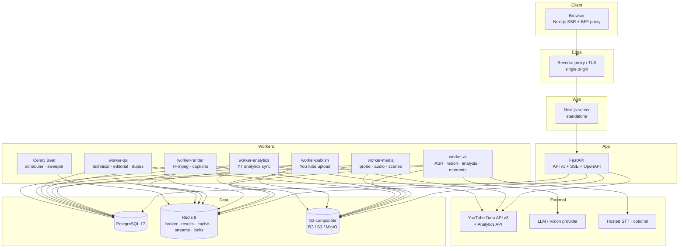
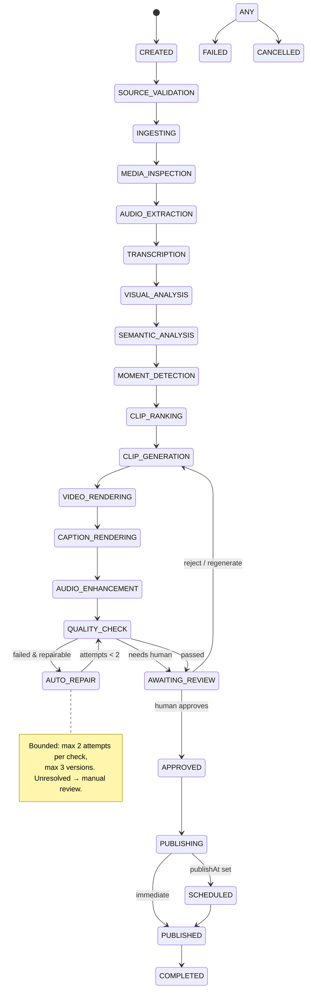
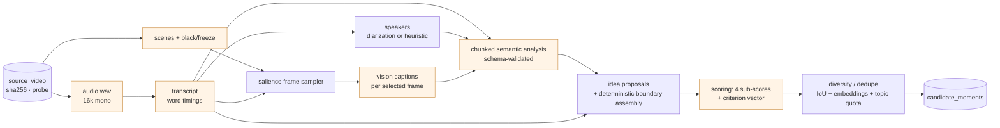
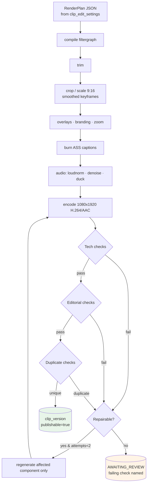
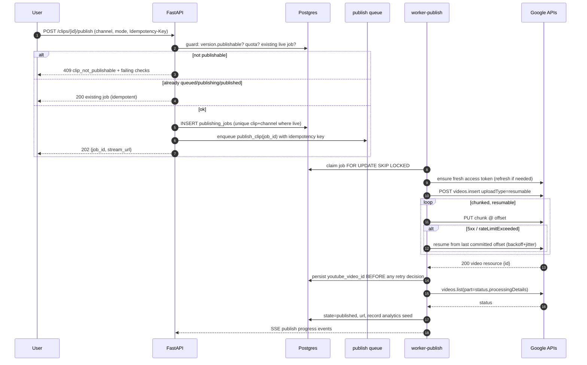
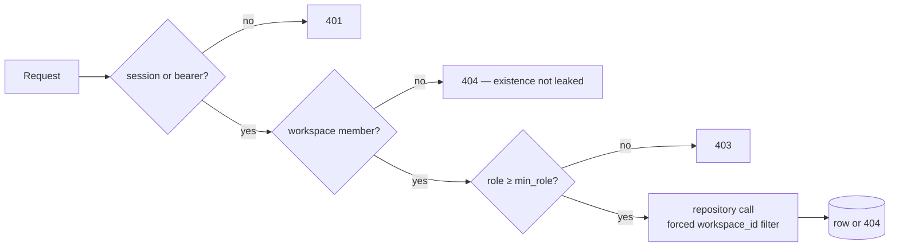

# AutoClipper AI — Diagrams

Rendered with Mermaid (GitHub, VS Code, and most Markdown viewers render these natively).

---

## 1. Container / deployment view



---

## 2. Project lifecycle (state machine)



Illegal transitions are rejected with `409 invalid_transition` by a single declarative graph
(`STAGE_GRAPH`) shared by API, orchestrator and tests.

---

## 3. Intelligence pipeline (data + checkpoints)



Every box is a checkpointed stage writing an artifact + `input_fingerprint`; a retry short-circuits
when the artifact already exists. Orange = paid/AI stages, so a failure downstream never re-pays them.

---

## 4. Render + QA loop



QA re-inspects the produced **file** and never trusts the RenderPlan. Only the latest passing report
makes a version publishable; failed versions are retained for comparison.

---

## 5. Publish path (duplicate-safe)



Failure after upload but before commit is recovered by looking up the recorded `youtube_video_id`
(or the `autoclip-id` correlation tag) — never by re-uploading.

---

## 6. Real-time event flow

```mermaid
sequenceDiagram
  participant B as Browser (EventSource)
  participant API as FastAPI /events
  participant R as Redis Stream
  participant W as Celery worker

  B->>API: GET /projects/{id}/events (Last-Event-ID?)
  API->>R: XRANGE replay from last id
  R-->>API: buffered transitions
  API-->>B: event: stage (replayed)
  W->>R: XADD stage/progress/clip events
  R-->>API: XREAD block
  API-->>B: event: stage|clip|job (streamed)
  Note over API,B: progress is null when no measurable denominator;<br/>ETA only after ≥2 comparable stages
```

---

## 7. Workspace isolation (authorization path)



Every repository function takes `workspace_id` as a required keyword argument — there is no
"fetch by id alone" helper, which makes cross-workspace access a type error rather than a code review
miss.
